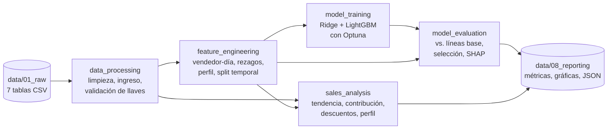

# Desempeño de las ventas — Proyecto Final ML for Business

[](https://github.com/Cynthiss/ML-Proyecto-Final/actions/workflows/ci.yml)
[](https://kedro.org)

**Reto 1:** analizar el desempeño de las ventas de una cadena de supermercados (enero–mayo 2018) para identificar tendencias y patrones, incluyendo el desempeño del personal de ventas (generación de ventas, tendencia, contribución y perfil para contratación), y proponer accionables de negocio.

**Integrantes:** Cynthia Santos, Antonio Valdez y Juan Diego
**Curso:** Machine Learning for Business — Facultad de Ciencias Económicas, 2026

---

## Problema de negocio

| Elemento | Definición |
|---|---|
| **Contexto** | Cadena de supermercados con 23 vendedores y ~6.7 millones de ventas en 129 días. La gerencia necesita saber cómo evolucionan las ventas y qué diferencia a sus vendedores para fijar metas, incentivos y criterios de contratación. |
| **Stakeholder** | Gerencia comercial y Recursos Humanos: fijan metas e incentivos por vendedor, la política de descuentos y el perfil de contratación. |
| **Pregunta de negocio** | ¿Cuánto venderá cada vendedor por día y qué factores, incluido su perfil (edad, antigüedad, género), explican su desempeño? |
| **Objetivo analítico** | Regresión: pronosticar la venta diaria de cada vendedor, comparar modelos de ML contra líneas base simples y explicar las variables con SHAP. Se complementa con un análisis estadístico de tendencia, contribución, descuentos y perfil. |
| **Métrica de éxito** | *Técnica:* MAE (error absoluto medio diario por vendedor) y MAPE en los últimos 28 días, nunca vistos por el modelo. *De negocio:* un modelo de ML solo se adopta si reduce el MAE de la mejor línea base en al menos 2%; si no, se prefiere la alternativa más simple. |
| **Impacto esperado** | Metas por vendedor con ~2% de error, incentivos enfocados en lo que realmente diferencia a los vendedores (ticket promedio), una política de descuentos revisada (Q132M otorgados sin aumento de volumen) y criterios de contratación respaldados por datos. |

## Resultados principales

| Tema | Hallazgo |
|---|---|
| **Pronóstico** | El **promedio histórico de cada vendedor** pronostica su venta diaria con un MAE de 32.3 mil (**2.2% de error**). LightGBM y Ridge, optimizados con Optuna, quedan prácticamente empatados (+0.3% de error), así que se recomienda la línea base: más simple de explicar e implementar. |
| **Tendencia** | Ventas estables, de ~Q233M por semana (+0.008% semanal). El día de la semana no influye (p = 0.87). |
| **Contribución** | Cada vendedor aporta entre 4.30% y 4.39% del total. La brecha entre el primero y el último es de 2.1%: 3 vendedores están por encima del promedio, 18 en el promedio y 2 por debajo. |
| **Qué diferencia a los vendedores** | El **ticket promedio** (p < 0.001; correlación 0.91 con el ingreso), no el número de ventas (p = 0.40). |
| **De dónde sale el ticket alto** | Los vendedores de mejor ticket **concentran más unidades en sus ventas de mayor valor** (rho = 0.90) y menos en las de menor valor (rho = −0.66). En total venden las mismas unidades, pero las ponen donde más ingreso generan. |
| **Descuentos** | El 20% de las ventas lleva descuento y suma Q132M (3% del ingreso bruto), pero las unidades por venta no cambian: 13.0 con 0%, 10% o 20% de descuento. |
| **Perfil para contratación** | Edad, antigüedad, edad al ser contratado y género **no** se relacionan con el desempeño (todos los p > 0.15). En el modelo, el perfil explica solo ~6% de la importancia según SHAP. |

**Recomendaciones:**
1. Fijar metas con el promedio histórico de cada vendedor.
2. Medir y premiar el ticket promedio, no el número de ventas, y entrenar al equipo en venta sugestiva: aumentar la cantidad cuando la venta es de alto valor, como ya hacen los vendedores de mejor ticket.
3. Revisar la política de descuentos, que hoy cede margen sin generar volumen.
4. Contratar por habilidades de venta (venta sugestiva o consultiva, evaluable con un caso práctico en la entrevista), sin filtros demográficos.

> **Limitación importante:** los datos son muy homogéneos: todos los vendedores venden casi lo mismo y la venta diaria varía solo ±2.8%. Esto sugiere un dataset sintético o simulado. Las conclusiones describen *estos* datos y deben validarse con información real antes de usarse en decisiones de compensación o contratación. Con solo 23 vendedores, las pruebas sobre el perfil tienen poca potencia estadística.

## Arquitectura de la solución



| Pipeline | Responsabilidad | Salidas principales |
|---|---|---|
| `data_processing` | Elimina `TotalPrice` (venía en 0) y descarta las ventas sin fecha. Valida rangos y llaves, calcula `Revenue = Price × Quantity × (1 − Discount)` y agrega a cada vendedor su edad y antigüedad. | `sales_primary`, `employees_clean`, `data_quality_report.json` |
| `feature_engineering` | Agrega las ventas por vendedor y día. Calcula rezagos y promedios móviles usando solo días anteriores (sin fuga de datos), agrega calendario y perfil, y separa los últimos 28 días como prueba. | `seller_daily`, `model_input_train`, `model_input_test` |
| `model_training` | Optimiza Ridge y LightGBM con Optuna (validación cruzada temporal, minimizando el MAE) y entrena los modelos finales. | `ridge_model.pkl`, `lightgbm_model.pkl`, `best_params.json`, `optuna_trials.csv` |
| `model_evaluation` | Compara los modelos contra 4 líneas base, aplica la regla de selección, calcula SHAP y genera las gráficas. | `model_metrics.csv`, `model_selection.json`, `feature_importance_shap.csv`, gráficas |
| `sales_analysis` | Arma la ficha por vendedor y corre las pruebas estadísticas de tendencia, contribución, descuentos y perfil. | `seller_summary.csv`, `sales_insights.json`, 7 gráficas |

## Estructura del repositorio

```
├── .github/workflows/ci.yml   # GitHub Actions: Ruff + pytest + kedro run
├── conf/
│   ├── base/                  # catálogo, parámetros y rutas (globals.yml)
│   └── ci/                    # entorno de CI: usa la muestra de data/00_sample
├── data/
│   ├── 00_sample/             # muestra versionada (0.5% de las ventas) para CI
│   ├── 01_raw/                # tablas completas del curso (NO versionadas)
│   └── 02_intermediate … 08_reporting/   # salidas generadas por kedro run
├── docs/erd.png               # diagrama entidad-relación
├── notebooks/
│   ├── 00_intro.ipynb         # introducción al dataset (material del curso)
│   └── 01_exploracion.ipynb   # exploración: calidad, outliers, patrones y decisiones
├── scripts/make_sample.py     # genera data/00_sample a partir de data/01_raw
├── src/sales_performance/pipelines/   # un paquete por pipeline (nodes.py + pipeline.py)
└── tests/                     # pruebas unitarias por pipeline + integración
```

## Instalación

Se requiere Python 3.10 o superior; el proyecto se probó con 3.12.

```bash
git clone https://github.com/Cynthiss/ML-Proyecto-Final.git
cd ML-Proyecto-Final
python -m venv .venv
source .venv/bin/activate        # Windows: .venv\Scripts\activate
pip install -r requirements.txt
pip install -e ".[dev]"
```

## Datos

Copiar las siete tablas del curso en `data/01_raw/`:

```
data/01_raw/
├── sales.csv  products.csv  categories.csv  employees.csv
└── customers.csv  cities.csv  countries.csv
```

`sales.csv` pesa ~500 MB y GitHub no acepta archivos de más de 100 MB, por eso `data/01_raw/` no se versiona. El diagrama entidad-relación está en [docs/erd.png](docs/erd.png).

## Ejecución

Pipeline completo (~30 segundos con los datos completos):

```bash
kedro run
```

Un pipeline específico:

```bash
kedro run --pipelines data_processing
kedro run --pipelines sales_analysis
```

Cambiar parámetros sin editar archivos, por ejemplo más trials de Optuna:

```bash
kedro run --params "model_training.optuna.n_trials=100"
```

Todos los parámetros están en `conf/base/parameters_*.yml`: fecha de corte, rezagos, ventanas, días de prueba, espacio de búsqueda de Optuna, umbral de selección y nivel de significancia.

### Ejecutar con la muestra (sin los datos completos)

```bash
kedro run --env ci
```

El entorno `ci` lee `data/00_sample/` y escribe en `data/ci/`, así no sobrescribe los resultados del entorno base. La muestra se regenera con `python scripts/make_sample.py`.

## Calidad de código y pruebas

```bash
ruff check .
ruff format --check .
pytest
```

Las pruebas unitarias cubren cada nodo con datos pequeños construidos a mano: limpieza, ausencia de fuga de datos en los rezagos, split temporal, regla de selección del modelo y pruebas estadísticas. La prueba de integración (`tests/test_run.py`) ejecuta el pipeline completo con la muestra.

GitHub Actions ([.github/workflows/ci.yml](.github/workflows/ci.yml)) corre en cada push y pull request a `main`:
1. instala las dependencias;
2. ejecuta Ruff;
3. ejecuta pytest;
4. corre `kedro run --env ci`.

## Decisiones de datos documentadas

| Problema encontrado | Decisión |
|---|---|
| `TotalPrice` = 0 en el 100% de las filas | Se elimina y se recalcula como `Price × Quantity × (1 − Discount)`. |
| 67,526 ventas (1%) sin `SalesDate` | Se descartan: no se pueden ubicar en el tiempo. Se reparten de forma pareja entre los vendedores (entre 4.1% y 4.6% de los faltantes por vendedor), así que no sesgan la comparación. |
| Mayo solo tiene datos hasta el día 9 | Las tendencias usan solo semanas completas. El periodo de prueba del modelo es por días, no por meses. |
| El código de país de Australia es `"NA"` | Se lee con `keep_default_na: false` para que no se convierta en valor faltante. |
| Duplicados, llaves huérfanas, cantidades o descuentos fuera de rango | Se validan en cada ejecución. No se encontró ninguno; si aparecen, el pipeline los descarta o se detiene con error. |

## Fuentes y herramientas

- Dataset de ventas compartido por el curso.
- [Kedro](https://kedro.org), [Optuna](https://optuna.org), [LightGBM](https://lightgbm.readthedocs.io), [scikit-learn](https://scikit-learn.org), [SHAP](https://shap.readthedocs.io), [SciPy](https://scipy.org), [Ruff](https://docs.astral.sh/ruff/).
